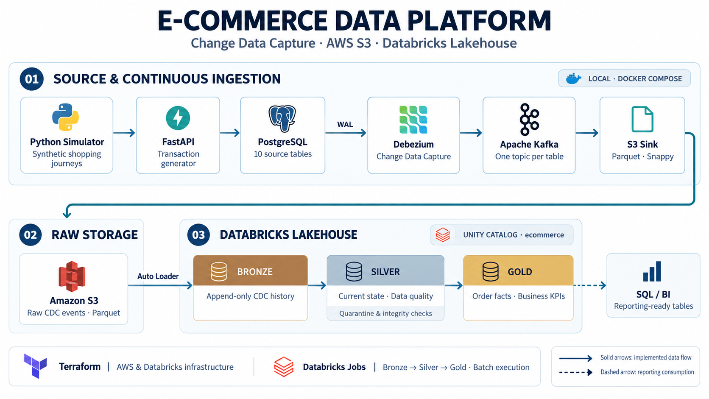

# Pipeline CDC e-commerce : PostgreSQL → Kafka → S3 → Databricks

Pipeline de données de bout en bout. Elle capture en continu chaque modification d'une base transactionnelle e-commerce (*Change Data Capture*), la dépose au format Parquet dans un data lake S3, puis la transforme dans Databricks selon une architecture medallion (bronze → silver → gold), jusqu'à obtenir des indicateurs métier prêts pour le reporting.

**Stack** : PostgreSQL 13 · Debezium 2.5 · Apache Kafka 3.7 (KRaft) · Kafka Connect S3 · AWS S3 · Databricks (Unity Catalog, Auto Loader, Delta Lake) · Terraform · Python (FastAPI, PySpark)

## Architecture



Le flux se découpe en trois blocs :

- **Source et ingestion** (en local, avec Docker Compose) : une API simule l'activité d'une boutique en ligne. Debezium capte chaque changement de la base, et Kafka Connect l'écrit dans S3.
- **Stockage** (AWS) : S3 sert de zone d'atterrissage brute, partitionnée par jour.
- **Transformation** (Databricks) : un job enchaîne les couches bronze, silver et gold dans le catalog Unity Catalog `ecommerce`.

## Rôle des composants

| Composant | Rôle | Configuration |
|---|---|---|
| **API FastAPI + simulateur** | Génèrent un trafic réaliste : paniers, commandes, paiements (environ 10 % d'échecs), expéditions, livraisons | `app/`, `simulator.py` (port 8000) |
| **PostgreSQL** | Base transactionnelle source (10 tables), avec la réplication logique activée (`wal_level=logical`) | `docker-compose.yaml` (port 5433) |
| **Debezium** | Lit le journal de transactions (WAL) via `pgoutput` et publie chaque `INSERT`, `UPDATE` et `DELETE` dans Kafka | `debezium-config.json` (port 8083) |
| **Kafka** | Transporte les événements, avec un topic par table : `ecommerce.public.<table>` | `docker-compose.yaml` (port 9092) |
| **Kafka Connect S3 Sink** | Écrit les événements dans S3 en Parquet (Snappy), par lots de 100 événements ou toutes les minutes | `s3-config-final.json` (port 8084) |
| **S3** | Data lake brut : `topics/ecommerce.public.<table>/bronze/YYYY/MM/dd/` | `terraform/` |
| **Databricks : Bronze** | Ingestion incrémentale (Auto Loader) de l'enveloppe Debezium brute, en ajout seul | `databricks/src/bronze_ingest.py` |
| **Databricks : Silver** | Rejeu du CDC pour obtenir l'état courant de chaque table, nettoyé et validé | `databricks/src/silver_transform.py` |
| **Databricks : Gold** | Table de faits des commandes et tables de KPIs | `databricks/src/gold_kpis.py` |
| **Terraform** | Provisionne le VPC, l'IAM, les buckets S3, le workspace Databricks, Unity Catalog et le cluster | `terraform/` |

## Éléments clés

- **CDC sans impact sur la source** : aucune requête n'est exécutée sur les tables. Debezium lit le WAL, ce qui capture aussi les suppressions et l'ordre exact des changements (LSN). Au premier démarrage, un snapshot initial charge les données existantes.
- **Bronze, l'historique complet** : chaque événement est conservé avec son enveloppe Debezium (`before`, `after`, `op`, `ts_ms`, `source`). Auto Loader mémorise les fichiers déjà lus, donc chaque exécution ne traite que les nouveaux.
- **Silver, l'état courant fiable** : pour chaque clé primaire, seul le dernier événement est retenu (ordre LSN). Les suppressions sont appliquées et les dates Debezium (en microsecondes) sont converties.
- **Qualité des données** : des règles par table (email valide, prix positif, statut connu…) isolent les lignes invalides dans `silver.quarantine`, avec le motif du rejet. Les tables `silver.dq_summary` et `silver.dq_orphans` suivent les volumes et l'intégrité référentielle.
- **Règles métier explicites en gold** : une commande n'est comptée comme vendue que si son dernier paiement est `success`. Un panier resté `active` plus d'une heure est considéré comme abandonné.
- **Infrastructure reproductible** : tout l'environnement cloud est décrit en Terraform. Les tables sont gouvernées par Unity Catalog (catalog `ecommerce`, schémas `bronze`, `silver` et `gold`).
- **Secrets cloud hors du code** : `.env` et `terraform.tfvars` sont exclus de Git. Le connecteur S3 utilise un utilisateur IAM dédié, limité au bucket brut.
- **Maîtrise des coûts** : le cluster s'arrête automatiquement après 30 minutes d'inactivité. Les fichiers bruts sont archivés en Glacier après 30 jours et supprimés après un an.

## Données produites (gold)

| Thème | Tables |
|---|---|
| Ventes | `fact_orders` (table centrale, une ligne par commande), `kpi_daily_sales`, `kpi_sales_by_country` |
| Produits et stock | `kpi_product_performance`, `kpi_category_sales`, `kpi_inventory_status` |
| Clients | `kpi_customer_rfm` (valeur vie client et segmentation) |
| Parcours et opérations | `kpi_cart_funnel`, `kpi_payment_methods`, `kpi_delivery_performance` |

## Lancer la pipeline

### Prérequis

- Docker Desktop, Python 3.12, Terraform 1.5 ou plus, l'AWS CLI configurée et la [Databricks CLI](https://docs.databricks.com/dev-tools/cli/install.html) avec le support des bundles.
- Un compte AWS et un compte Databricks sur AWS, avec :
  - un metastore Unity Catalog nommé `metastore_aws_us_west_2` dans la région `us-west-2` ;
  - deux service principals *account admin*, chacun avec un secret OAuth (scope `all-apis`) : l'un pour le compte (création du workspace), l'autre pour le workspace (Unity Catalog et cluster).

Les commandes ci-dessous sont écrites pour bash (Linux, macOS, WSL ou Git Bash sous Windows), et se lancent depuis la racine du dépôt.

### 1. Provisionner l'infrastructure cloud

Créer le fichier `terraform/terraform.tfvars` :

```hcl
project_name   = "my-data-project"   # préfixe des buckets S3 : doit être unique au monde
aws_region     = "us-west-2"
workspace_name = "my-data-workspace"

databricks_account_id              = "<id du compte Databricks>"
databricks_client_id               = "<service principal du compte : application id>"
databricks_client_secret           = "<service principal du compte : secret OAuth>"
databricks_workspace_client_id     = "<service principal du workspace : application id>"
databricks_workspace_client_secret = "<service principal du workspace : secret OAuth>"
```

Appliquer ensuite en deux passes. Le catalog Unity Catalog stocke ses tables dans le bucket créé par la première passe.

```bash
cd terraform
terraform init
terraform apply -target="module.aws"
terraform apply
cd ..
```

> Reporter l'URL du workspace (`terraform -chdir=terraform output -raw databricks_workspace_url`) dans `databricks/databricks.yml`. Si `project_name` ou `workspace_name` ont été modifiés, mettre aussi à jour le nom du bucket dans `s3-config-final.json`, ainsi que le bucket et le nom du cluster dans `databricks/databricks.yml`.

### 2. Démarrer la pile locale

```bash
cp .env.example .env
terraform -chdir=terraform output -raw kafka_iam_access_key_id       # valeur de AWS_ACCESS_KEY_ID
terraform -chdir=terraform output -raw kafka_iam_secret_access_key   # valeur de AWS_SECRET_ACCESS_KEY
```

Reporter ces deux valeurs dans `.env`. Ce fichier est lu à la fois par Docker Compose (clés du connecteur S3) et par l'API (`DATABASE_URL`). Démarrer ensuite les services :

```bash
docker compose up -d
```

Au premier démarrage, Kafka Connect télécharge le plugin S3. Attendre que `curl -s http://localhost:8084/connectors` réponde (une à deux minutes).

### 3. Lancer l'API et enregistrer les connecteurs

```bash
python -m venv venv
source venv/bin/activate          # Git Bash sous Windows : source venv/Scripts/activate
pip install -r requirements.txt
uvicorn app.main:app --port 8000
```

L'API crée les tables PostgreSQL au démarrage. Dans un second terminal :

```bash
curl -X POST -H "Content-Type: application/json" --data @debezium-config.json http://localhost:8083/connectors
curl -X POST -H "Content-Type: application/json" --data @s3-config-final.json http://localhost:8084/connectors

# Les deux connecteurs doivent être à l'état RUNNING
curl -s http://localhost:8083/connectors/ecommerce-postgres-cdc/status
curl -s http://localhost:8084/connectors/s3-sink-connector/status
```

### 4. Générer de l'activité

```bash
python simulator.py
```

Le simulateur crée 4 entrepôts, 5 000 produits et 100 000 clients, puis joue 50 000 parcours d'achat. Les premiers fichiers Parquet arrivent dans S3 au bout d'une minute environ :

```bash
aws s3 ls s3://my-data-project-kafka-raw/topics/ --recursive | head
```

### 5. Exécuter les transformations Databricks

```bash
databricks auth login --host "$(terraform -chdir=terraform output -raw databricks_workspace_url)"
cd databricks
databricks bundle deploy
databricks bundle run ecommerce_medallion
```

Le job `ecommerce-medallion` enchaîne `bronze_ingest`, `silver_transform` puis `gold_kpis` sur le cluster créé par Terraform. Une planification horaire est définie, mais en pause par défaut. Le notebook `notebooks/00_explore_bronze.py`, synchronisé lors du déploiement, permet d'inspecter les données de chaque couche.

### 6. Arrêter l'environnement

```bash
docker compose down                   # les volumes locaux sont conservés
terraform -chdir=terraform destroy    # supprime toute l'infrastructure cloud
```

> **Coûts** : la NAT gateway est facturée en continu (environ 33 $/mois hors trafic), et le cluster à chaque exécution. Attention : `terraform destroy` supprime aussi les buckets **et leurs données** (`force_destroy = true`).

## Structure du dépôt

```
.
├── app/                    API FastAPI : modèle de données et routes
├── simulator.py            Générateur de trafic e-commerce
├── docker-compose.yaml     PostgreSQL, Kafka, Debezium, Kafka Connect S3 (+ MinIO, non utilisé par défaut)
├── debezium-config.json    Connecteur source CDC
├── s3-config-final.json    Connecteur S3 Sink
├── terraform/              Infrastructure AWS et Databricks
└── databricks/             Bundle Databricks : job bronze → silver → gold
```

## Évolutions prévues

- Tableau de bord Databricks AI/BI sur les tables gold
- Couche gold portée en dbt (modèles et tests)
- Tests unitaires des transformations et intégration continue
